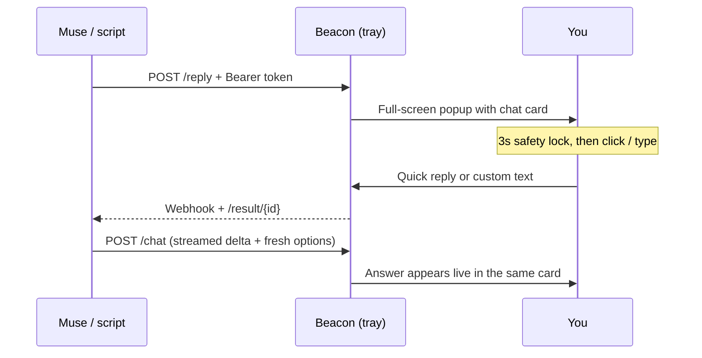

<div align="center">

# Beacon

**Turn an HTTP request into a big, beautiful, full-screen Windows or Linux popup.**


</div>

100% AI Generated!! Look I hate ai slop as much as the next guy, however I find this app to be genuinely useful if you use muse.ai
I personally use muse, and I find myself forgetting about it often, it'll get stuck on completing a captcha, or asking me for a verification code sent to my phone, and I wouldn't see it. This has has caused a lot of wasted tokens from the task expiring and it having to restart it, so I had OpenCode build this app. I take no credit for this application, nor do I claim to have built it myself, the original idea and concept / design was all curated and perfected by me, however I did not touch a single bit of code and I think disclosing that is the proper way to release a AI generated application. The following documentation and overview is AI generated as well. Anyway thank you for taking the time to read, as well for using this app! (Linux version is NOT complete and comes with many bugs (WIP), as far as I can tell the windows version is functioning as intended for the time being at least in my environment (tested on different devices and screen sizes) if you notice any bugs please let me know in the issues tab)

---------------------------

Beacon is a tiny tray app that lets an AI agent (or any script) ask for your
attention without assuming you are watching the screen. It listens for
token-authenticated HTTP requests over a private Tailscale network and shows a
modern, full-screen overlay with a persistent chat card, quick replies, live
streaming responses, and human-in-the-loop approval for admin commands.

---

## Contents

- [Features](#features)
- [How it works](#how-it-works)
- [Quick start](#quick-start)
- [What you can send](#what-you-can-send)
- [Chat, replies and streaming](#chat-replies-and-streaming)
- [Admin shell approval](#admin-shell-approval)
- [Safety and display behavior](#safety-and-display-behavior)
- [Configuration](#configuration)
- [Documentation](#documentation)
- [Project structure](#project-structure)
- [Build from source](#build-from-source)
- [Roadmap](#roadmap)
- [License](#license)

## Features

- **Full-screen overlay** with a translucent backdrop that spans every monitor,
  while the card itself is centered on a single display — laptop + TV included.
- **Persistent chat card** on every alert type, with transcript, Muse logo avatar,
  your account photo, and live streaming with a typing indicator.
- **Quick replies** that adapt to screen size and DPI, a custom composer
  (`Enter` to send, `Shift+Enter` for a newline), and dynamic buttons that Muse
  can replace with each new message.
- **Desktop-friendly** — the Windows taskbar (and Linux panels) stay visible and
  clickable above the overlay.
- **Admin approval** with an exact command preview, optional elevation (UAC on
  Windows, `pkexec` on Linux), and a global off switch that returns HTTP 403.
- **3-second safety lock** on every actionable control; clicking outside never
  dismisses a prompt.
- **Token-authenticated HTTP** with many aliases and payload formats, designed
  for Tailscale but usable on any private network.
- **No dependencies at runtime** — self-contained Windows app with a themed
  `Beacon-Setup.exe` installer, or a native Avalonia Linux AppImage.
- **One-click updater** — settings has a **Check for updates** button that uses the
  GitHub Releases feed (no installer browsing required).
- **Re-open last notification** — the tray menu can bring back the most recent popup
  if you dismissed it. Reply and shell prompts are never re-armed this way.
- **Confirmed downgrade** — the installer asks before replacing a newer installation;
  silent one-click updates never downgrade.
- **Never disruptive** — Beacon never closes or restarts Tailscale, Stremio,
  other apps, or the computer.

## How it works



## Quick start

1. Run `Beacon-Setup.exe` on the target Windows PC, approve the UAC prompt, and
   allow the app through the firewall when prompted. The installer uses the same
   dark theme as Beacon and preserves your existing settings. If Beacon is already
   installed, a **Repair** button appears; use it to reinstall at 1.0.1.
2. **Advanced options** in the installer lets you change the installation folder and
   the app-data folder before installing. By default these are
   `C:\Program Files\Beacon` and `%APPDATA%\Beacon`.
3. Double-click the tray icon (or right-click → **Open settings**).
4. Note the listening URL, port (default `8765`), secret token, and the Tailscale
   address Beacon detected.
5. Choose your clock format and whether admin shell requests are allowed, then
   press **Save settings**.
6. Give the URL and token to your AI agent. See [muse.md](muse.md) for a complete
   no-context setup prompt.

Settings live in `%APPDATA%\Beacon\settings.json` on Windows and
`~/.config/Beacon/settings.json` on Linux, outside the app folder.

### Linux

1. Download `Beacon-x86_64.AppImage` from the release, make it executable with
   `chmod +x Beacon-x86_64.AppImage`, and run it. No installation is required.
2. Open the tray icon → **Open settings** to copy the listening URL and token.
3. To start Beacon with your desktop session, enable **Start with Linux session**;
   this writes `~/.config/autostart/Beacon.desktop`.
4. Use **Check for updates** in settings to replace the running AppImage with the
   newest release in one click.

The Linux build is a native Avalonia port — not Wine — and uses the same HTTP
API, settings format, chat/quick-reply behavior, and safety lock as Windows.

### Test it

```powershell
$token = 'PASTE_TOKEN_HERE'

$body = @{
    title   = 'Captcha needs you'
    message = 'Muse is waiting for you to solve a captcha.'
    type    = 'captcha'
    source  = 'Muse.ai'
    code    = '482-913'
    duration = 'never'
    actions = @(@{ label = 'Copy code'; copy = '482-913' })
} | ConvertTo-Json -Compress -Depth 6

Invoke-RestMethod -Uri 'http://<TAILSCALE_HOST_OR_IP>:8765/notify' `
  -Method Post `
  -Headers @{ Authorization = "Bearer $token" } `
  -Body $body -ContentType 'application/json'
```

Or with curl:

```bash
curl -X POST "http://<TAILSCALE_HOST_OR_IP>:8765/notify?token=YOUR_TOKEN" \
  -H "Content-Type: application/json" \
  -d '{"title":"Hello","message":"A popup from Muse","type":"info"}'
```

Check that Beacon is alive without a token:

```powershell
Invoke-RestMethod http://127.0.0.1:8765/health
```

## What you can send

| Endpoint | Purpose |
| --- | --- |
| `/notify` | Show a popup (many theme aliases such as `/captcha`, `/verification`, `/alert`) |
| `/reply` | Popup + quick replies + persistent chat card |
| `/shell` | Ask for approval before running a command (Windows or Linux) |
| `/chat` | Stream Muse's answer into the chat card |
| `/result/{id}` | Poll a reply or approval result |
| `/health` | Status JSON, no token needed |
| `/clear` | Dismiss the popup and empty the queue |

Beacon accepts JSON objects, plain text, form data, and GET query parameters.
Field names are case-insensitive with generous aliases. Highlights: `title`,
`message` (Markdown), `type`, `code`, `source`, `details`, `image`, `progress`,
`actions`, `duration`, `sound`, `color`, and `raw`.

See the [full API reference](docs/API.md) for every field, alias, and response shape.

## Chat, replies and streaming

`POST /reply` opens the popup plus a docked chat card. Choosing a quick reply or
typing a custom answer keeps the card open so Muse can answer in the same
conversation. Every answer has a stable id: the first uses the original request
id, and later answers use `-r2`, `-r3`, and so on.

Muse streams its answer with small deltas:

```json
{ "id": "15e8c4af", "delta": "Working " }
{ "id": "15e8c4af", "delta": "on it… " }
{ "id": "15e8c4af", "delta": "", "done": true }
```

Fresh quick-reply buttons can be attached to any chat message:

```json
{
  "id": "15e8c4af-r2",
  "delta": "Here are the matches. ",
  "options": [
    { "label": "Apply all", "value": "apply_all" },
    { "label": "Skip", "value": "skip" }
  ]
}
```

`"options": []` hides the button section; omitting `options` leaves the current
buttons unchanged. Label length and button count adapt to the chat-card width.

## Admin shell approval

```json
{
  "title": "Admin approval needed",
  "message": "Clear the stale build cache.",
  "command": "echo Beacon shell test",
  "shell": "cmd",
  "elevated": false,
  "wait": true,
  "waitTimeout": 60
}
```

Nothing runs until **Approve & run** is clicked. `elevated: true` triggers a real
Windows UAC prompt or, on Linux, `pkexec` when available. Turn off **Allow admin
shell requests** in settings to reject all shell endpoints with `403` before a
popup is created.

## Safety and display behavior

- Every action control is locked for **3 seconds** after a popup appears.
- Clicking the backdrop never dismisses the prompt; moving the mouse away never
  selects or tints the screen.
- The translucent backdrop covers the full virtual screen, but the card is
  centered on the display under the cursor (falling back to the primary display),
  so it is never cut off on a laptop + TV setup.
- Plugging in a display or changing resolution re-fits the popup automatically.
- The Windows taskbar (and Linux desktop panels) are kept above the overlay.
- Beacon never restarts your PC, Tailscale, Stremio, or any other app.

## Configuration

All options are in the tray settings window:

| Setting | Default | Notes |
| --- | --- | --- |
| Port | `8765` | Restart the listener after changing |
| Bind interface | Any (Tailscale) | Loopback option available |
| Require secret token | On | Generate/copy/rotate the token here |
| Auto-dismiss | `20` seconds | `0` / `"never"` keeps the popup sticky |
| Sound | On | Themed notification sounds |
| Start with Windows / Linux session | Off | Adds a per-user startup entry |
| Clock format | 24-hour | Choose 12-hour for AM/PM |
| Allow admin shell requests | On | Off returns 403 for `/shell` |

## Documentation

- [docs/API.md](docs/API.md) — endpoints, authentication, fields, results, streaming
- [docs/ARCHITECTURE.md](docs/ARCHITECTURE.md) — components, threading, display model
- [docs/SECURITY.md](docs/SECURITY.md) — auth, network and webhook guidance
- [muse.md](muse.md) — ready-to-use Muse setup prompt (placeholders only)
- [docs/MUSE_PROMPT.md](docs/MUSE_PROMPT.md) — alternate copy/paste prompt
- [CHANGELOG.md](CHANGELOG.md) — release history
- [CONTRIBUTING.md](CONTRIBUTING.md) — build and style notes

## Project structure

```text
Beacon/
├── src/Beacon/                 # WPF application
│   ├── App.xaml(.cs)           # Tray app, routing, auth
│   ├── Assets/                 # Icons and Muse logo
│   ├── Models/                 # Payload, chat and interaction models
│   ├── Services/               # HTTP, parsing, chat, settings, display helpers
│   └── Views/                  # Overlay and settings windows
├── src/Beacon.Installer/       # Themed single-file EXE installer (WPF)
├── src/Beacon.Linux/           # Native Avalonia app + AppImage source
├── .github/workflows/          # Windows build + Linux AppImage release artifact
├── tools/                      # Build and UI inspection scripts
├── docs/                       # API, architecture, security, extra prompts
├── muse.md                     # Release-safe Muse setup prompt
├── CHANGELOG.md
└── README.md
```

## Build from source

Prerequisites: Windows 10/11 x64 and .NET 8 SDK. A local tool copy can be placed
in `.tools/dotnet`; otherwise the script uses `dotnet` from PATH.

```powershell
# Publishes the app, embeds it in the themed installer, and produces Beacon-Setup.exe
powershell -ExecutionPolicy Bypass -File tools\build_installer.ps1
```

For Linux, GitHub Actions builds `Beacon-x86_64.AppImage` from
`src/Beacon.Linux/Beacon.Linux.csproj` on `ubuntu-latest` and uploads it as an
artifact for attachment to the release.

## Roadmap

- Signed release assets
- Configurable hotkey to summon the overlay
- Optional per-request sound override in the payload
- Localization of popup text

## License

Released under the [MIT License](LICENSE).
