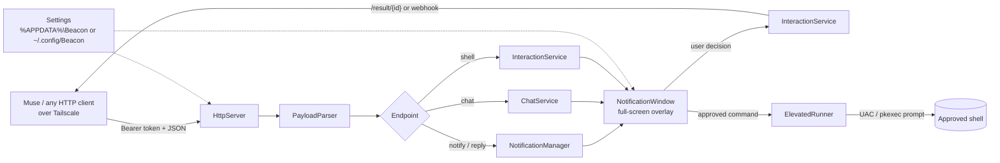

# Architecture

Beacon is a single self-contained WPF application (`net8.0-windows`, `win-x64`).
It has no external NuGet dependencies and ships with a single-file, themed EXE installer.

## Components

| File | Responsibility |
| --- | --- |
| `App.xaml.cs` | Application lifetime, tray icon, settings window, HTTP request dispatch, token check |
| `Services/HttpServer.cs` | Raw `TcpListener` HTTP/1.1 server. Avoids `HttpListener` URL-ACL and admin requirements |
| `Services/PayloadParser.cs` | Case-insensitive field aliases, type coercion, duration/code parsing, payload normalization |
| `Services/NotificationManager.cs` | Queue and serialize popups so several requests appear one after another |
| `Views/NotificationWindow.xaml(.cs)` | Full-screen translucent overlay, themed card, chat panel, quick replies, composer, countdown and safety lock |
| `Services/ChatService.cs` | Persistent transcript, streaming deltas, Muse/user avatars, observable changes |
| `Services/InteractionService.cs` | Pending request ids, results, webhook delivery, follow-up `-rN` ids |
| `Services/ElevatedRunner.cs` | Launches `Beacon.exe --run-elevated <requestPath>` with `Verb="runas"` when UAC is needed |
| `Services/Settings.cs` | JSON persistence, token generation, bind/port, clock format, shell permission |
| `Services/MonitorSelector.cs` | Chooses the display under the cursor (fallback: primary) for popup centering |
| `Services/QuickReplyLimits.cs` | Derives button count and label length from chat-card width |
| `Services/RichTextParser.cs` | Safe subset of Markdown and HTML for message bodies |
| `Services/NetworkHelper.cs` | Detects the Tailscale IPv4 for the settings display |

## Display model

The overlay window covers `SystemParameters.VirtualScreen*` so the translucent
backdrop spans every attached display. The card itself is translated so its center
matches the center of one display. `PointFromScreen` converts physical monitor
bounds into device-independent pixels, which keeps mixed-DPI laptop + TV setups
correct. `SystemEvents.DisplaySettingsChanged` and `DpiChanged` re-run the sizing.
The taskbar is re-asserted as topmost after the overlay appears so it never looks
hidden.

## Threading and lifetime

- The HTTP server runs on a background loop; requests are dispatched to the UI
  thread through the WPF dispatcher.
- Results are stored in a `ConcurrentDictionary` immediately, so polling
  `/result/{id}` is not timing-sensitive.
- Webhooks are fire-and-forget with a short timeout — a slow receiver never
  blocks the user interface.
- Popups are queued and shown sequentially. `POST /clear` drops the queue.

## Safety guarantees

- Actionable controls are disabled for the first 3 seconds after a popup appears.
- Clicking the backdrop never dismisses a prompt; moving the mouse does not select
  or tint the screen.
- Beacon never closes or restarts Tailscale, Stremio, or the computer.
- Shell commands only run after approval, and are rejected outright when the
  shell permission is disabled.

## Installer

`tools/build_installer.ps1` republishes the app, zips it into
`src/Beacon.Installer/Payload/BeaconPayload.zip`, and publishes the installer as a
single self-contained `Beacon-Setup.exe`. The installer is a WPF app with the same
dark theme as Beacon. It detects an existing install (showing a **Repair** button),
replaces the binaries, writes a registry uninstall entry, and creates a Start menu
shortcut. **Advanced options** can override the install and app-data folders; the
chosen data path is written to `Beacon.paths.json` beside the app and read by
`SettingsService`. User settings are never touched.

The v1.0.0 release build also includes a one-time downgrade path, enabled only by a
local, gitignored `OneTimeDowngrade.local.props` file. It is not committed, so future
builds from the repository reject attempts to downgrade a newer installation.
